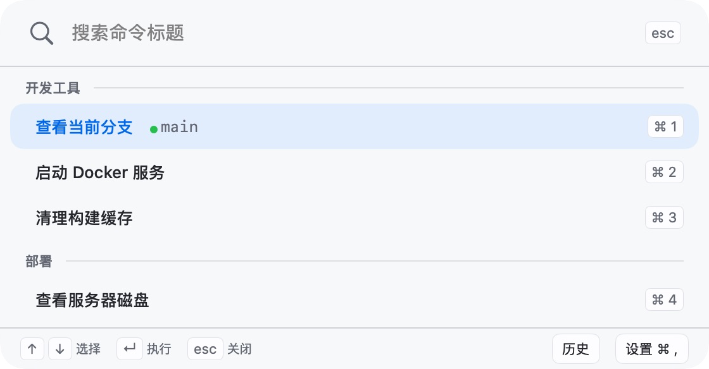
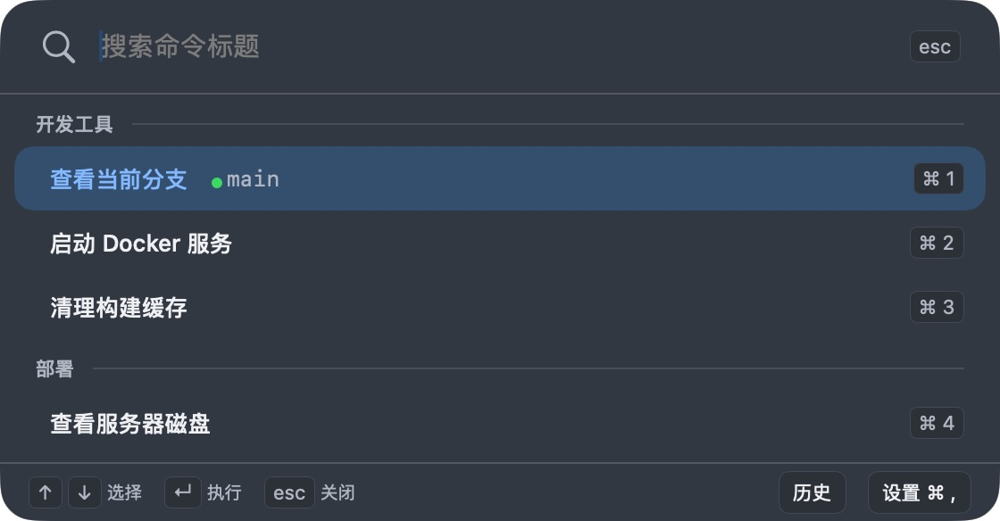

# MenuBarExecutor

把常用 Shell 命令放进 macOS 菜单栏。按快捷键打开面板，输入名称，回车执行。

[下载](https://github.com/11ze/menu-bar-executor/releases/latest) · [交互预览](https://11ze.github.io/menu-bar-executor/)

- 按名称搜索命令，支持键盘导航与 `⌘1` 至 `⌘9` 执行。
- 打开面板时自动执行指定命令，行内查看与复制结果。
- 命令分组、工作目录、执行历史与 JSON 配置导入导出。
- 原生深浅色界面，可调整并保存面板尺寸。

macOS 12.0+ · SwiftUI + AppKit · [MIT](LICENSE)

交互预览使用示例数据，不执行真实命令。

## 界面




## 安装

1. 从 [Releases](https://github.com/11ze/menu-bar-executor/releases/latest) 下载并解压，将 `MenuBarExecutor.app` 拖入应用程序文件夹。
2. 打开应用。若被系统拦截，在系统设置的“隐私与安全性”中允许打开。

## 从源码构建

需要 Xcode 15.0+ 和 [XcodeGen](https://github.com/yonaskolb/XcodeGen)。

```bash
git clone https://github.com/11ze/menu-bar-executor.git
cd menu-bar-executor
brew install xcodegen
xcodegen generate
xcodebuild -project menu-bar-executor.xcodeproj \
  -scheme MenuBarExecutor \
  -configuration Release \
  -derivedDataPath /tmp/menu-bar-executor-build build
open /tmp/menu-bar-executor-build/Build/Products/Release/MenuBarExecutor.app
```

派生数据放在 `/tmp`，避免 iCloud 同步目录的扩展属性导致签名失败。修改 `project.yml` 后需重新运行 `xcodegen generate`。

运行测试：

```bash
xcodebuild test -project menu-bar-executor.xcodeproj \
  -scheme MenuBarExecutorTests \
  -destination 'platform=macOS' \
  -derivedDataPath /tmp/menu-bar-executor-build
```

开发约定见 [开发规范](docs/conventions.md) 与 [领域词汇表](CONTEXT.md)。交互预览的发布方式见 [设计说明](docs/design/README.md#在线预览与发布)。

## 许可证

[MIT](LICENSE)
